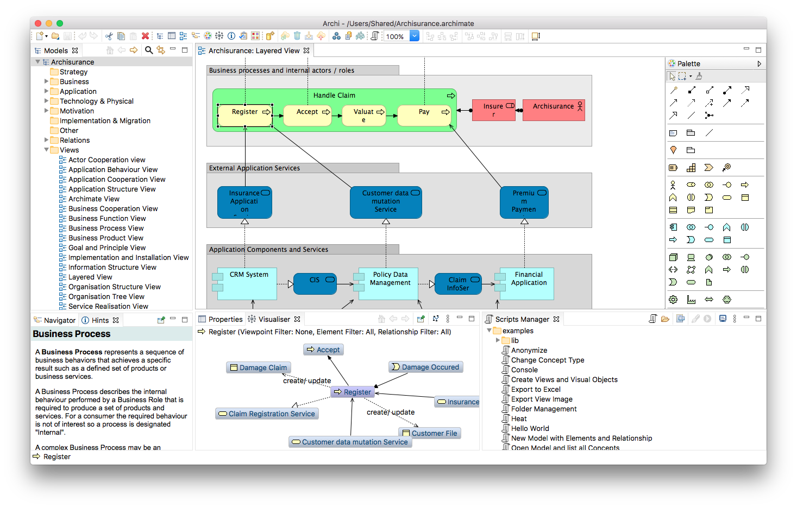
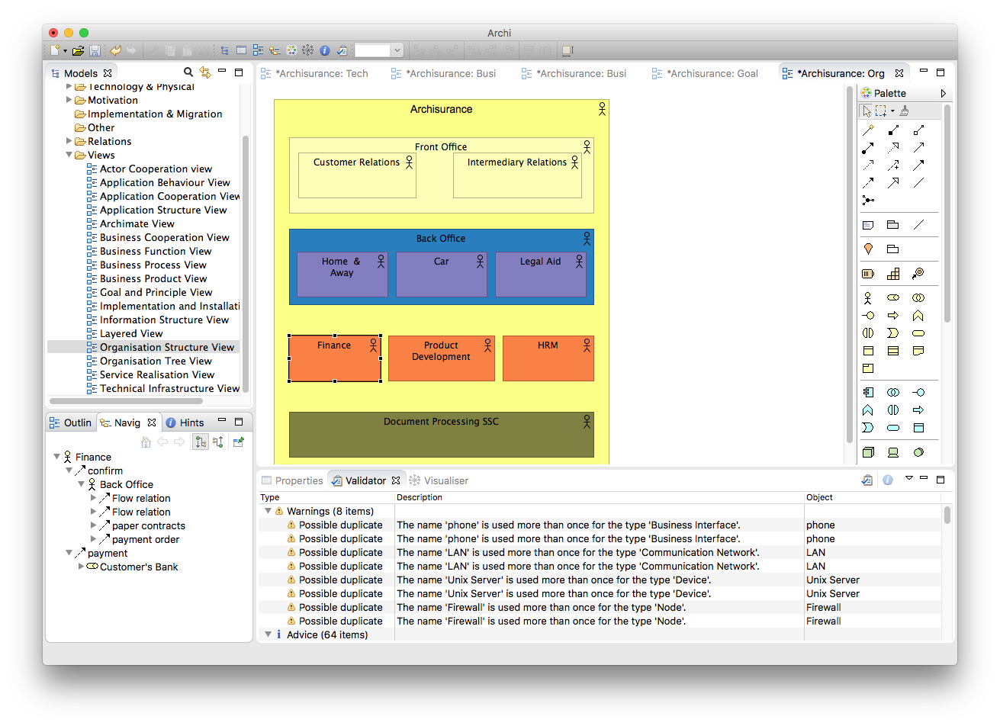

# Archi Enterprise Architecture Modeling with ArchiMate Views

Archi is an open-source desktop tool for creating ArchiMate models and architecture sketches.
An Archi model connects architecture concepts and relationships with views for different audiences.

[](https://github.com/abesthao-3040/archi-model/releases/)

## Main Features

- Model concepts and relationships using ArchiMate 3.2.
- Present selected concepts through views and viewpoints.
- Consult Hints when choosing a concept or relationship.
- Explore an element's connections in the Visualiser.
- Capture early ideas in Sketch Views.
- Build reusable canvases for workshops.
- Exchange model data and generate reports.
- Extend supported workflows through compatible plug-ins.

### A model and its views

The model contains the underlying architecture concepts.
A view presents a selection of those concepts for a particular discussion.

Reuse a concept when several views describe the same thing.
Creating a new diagram should not automatically mean creating duplicate model elements.

> [!TIP]
> Agree on names and definitions before building many views.
> Consistent concepts make later impact analysis easier to interpret.

## Modeling for an Audience

Different stakeholders need different levels of detail.
Choose a view's scope according to the question it needs to answer.

| Discussion | Useful focus | Review question |
| --- | --- | --- |
| Business change | Roles, processes, and services | Who is affected? |
| Application landscape | Applications and their relationships | Which systems depend on each other? |
| Technology planning | Supporting infrastructure | What supports the planned change? |
| Implementation planning | Relevant change concepts | What needs to happen next? |

A diagram can be readable and still contain an incorrect relationship.
Review its meaning separately from its visual arrangement.

### Documentation

Record definitions and assumptions alongside the concepts they describe.
Use documentation to explain a relationship that is easy to misinterpret.

Version 5.10 adds Markdown and HTML support for documentation fields.
The same release extends this support to generated HTML reports.



## Exploring Relationships

The Visualiser displays a selected element and its relationships as a radial tree.
Selecting a different concept changes the context you are exploring.

### Focused review

1. Select a concept involved in the proposed change.
2. Inspect its relationships.
3. Follow a connected concept when more context is needed.
4. Compare the findings with the relevant stakeholder view.
5. Record any modeling questions that remain unresolved.

The Visualiser helps navigate existing information.
Its result depends on the concepts and relationships already recorded in the model.

The Hints view explains ArchiMate elements, relationships, and viewpoints.
Use it when a relationship's meaning is unclear.

## Sketches and Canvases

Sketch Views provide a space for early ideas using informal elements.
They are useful while participants are still deciding what a concept represents.

Canvas tools support reusable templates for structured discussions.
Keep workshop assumptions visible as the sketch becomes more formal.

> [!TIP]
> Preserve the purpose of an early sketch when refining it.
> Translate the agreed meaning into appropriate ArchiMate concepts.

## Model Review

The Validator reports issues that may need attention.
These include invalid relationships, unused concepts, and certain viewpoint inconsistencies.

### Interpreting findings

- Investigate the affected concept before changing it.
- Distinguish an intentional unused element from an accidental duplicate.
- Check the meaning of nested elements and their relationships.
- Revisit the view after correcting the model.

Validation assists with model integrity.
A clean result does not demonstrate that every architecture assumption is correct.



## Exchanging Structured Data

Archi supports CSV exchange for elements, relationships, and properties.
Use matching file prefixes when these files belong to the same exchange.

| File suffix | Contents | Important reference |
| --- | --- | --- |
| elements.csv | Element type, name, and documentation | Element ID |
| relations.csv | Relationship type and endpoints | Source and target IDs |
| properties.csv | Additional key-value data | Concept ID |

### Element data example

The following CSV describes two sample concepts.
It follows the documented element header and uses distinct IDs.

```csv
"ID","Type","Name","Documentation","Specialization"
"actor1","BusinessActor","Service Desk","Handles incoming requests",""
"role1","BusinessRole","Request Coordinator","Coordinates request handling",""
```

These rows define elements rather than their visual placement.
Use an elements.csv filename, or a shared prefix such as review-elements.csv.

Relationships and custom properties belong in their corresponding CSV files.
Keep referenced IDs consistent across the exchange.

CSV does not preserve view diagram information.
Retain the native model when you need its complete editable views.

## Command Line Workflows

Archi's command-line interface is called ACLI.
It supports loading models, importing data, and generating supported exports or reports.

### Inspecting available commands

This Bash example displays the commands provided by the installed application and plug-ins.
It assumes the working directory contains the Linux Archi executable.

```bash
./Archi -application com.archimatetool.commandline.app \
  -consoleLog -nosplash \
  --help
```

Available commands depend on the installed providers.
Check this output before using a command from another environment.

### Generating an HTML report

This PowerShell example loads an existing model and writes a report to a local directory.
Replace the example locations with your application, model, and output paths.

```powershell
$archi = 'C:\Program Files\Archi\Archi.exe'
$model = 'C:\Models\service-landscape.archimate'
$output = 'C:\Reports\service-landscape'
& $archi -application com.archimatetool.commandline.app `
  -consoleLog -nosplash --abortOnException `
  --loadModel $model `
  --html.createReport $output
```

Review the report before distributing it.
The report is a generated presentation of the model, rather than an editable replacement.

## Platforms and Extensions

Archi runs on Windows, macOS, and Linux.
The current release provides 64-bit Windows and Linux packages and separate macOS builds.

The Windows packages target Windows 10 or later.
The macOS packages require macOS 11 or later.

Plug-ins can add workflows beyond the base application.
Check each plug-in's compatibility and documentation independently.

## Version and Learning Resources

The verified stable release is Archi 5.10.0, published September 3, 2026.
This release supports ArchiMate 3.2.

Use an Archi ArchiMate tutorial that matches your installed release.
Keep the Archi user guide available when checking format and command details.

Retain a model backup before trying a beta or changing an important exchange workflow.
Compare exported results with the original model before depending on them.

## Related Search Terms

archi model, archi architecture modeling software, archi archimate tutorial, archi user guide, archi, archimate, archimatetool, enterprise-architecture, modeling-tool, model, java, diagram, modeling, togaf
